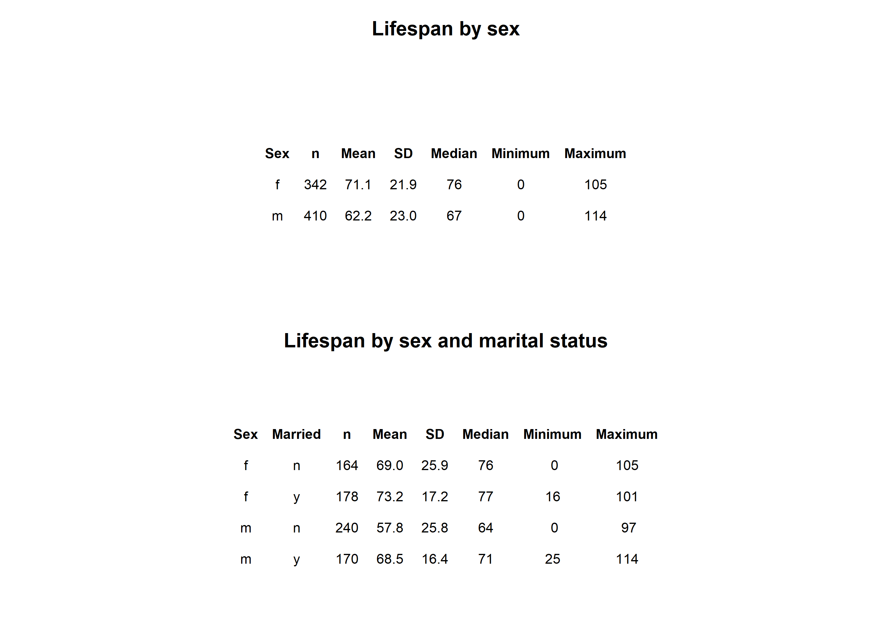

```{=latex}
\onecolumn
\begingroup
\thispagestyle{empty}
\sffamily

% Publication line and journal masthead
\noindent
\begin{minipage}[t]{0.66\linewidth}
  \scriptsize
  Ramos. \textit{Survivorship Curves of Sunset Hill Cemetery}
  \hfill (2026) 1:1\\
  Valdosta State University, Ecology and Evolution
\end{minipage}
\hfill
\begin{minipage}[t]{0.30\linewidth}
  \raggedleft
  \large Cemetery Demography\\[-2pt]
  \large BIOL 3250
\end{minipage}

\vspace{0.28in}

% Article-type band
\noindent
\colorbox{reportred}{%
  \parbox{\dimexpr\linewidth-2\fboxsep\relax}{%
    \color{white}
    \textbf{RESEARCH ARTICLE}\hfill
    \textbf{CLASS PROJECT}
  }%
}

\vspace{0.18in}

% Title and author line
\noindent
{\fontsize{23}{27}\selectfont
\textbf{Lifespan is Effected by Sex and Marital Status}\par}

\vspace{0.12in}

\noindent
{\small
Josimar Ramos\textsuperscript{1,*}
}

```{r}

```
\vspace{0.08in}

% Structured abstract
\setlength{\fboxsep}{6pt}
\noindent
\fcolorbox{reportred}{white}{%
  \begin{minipage}{\dimexpr\linewidth-2\fboxsep-2\fboxrule\relax}
    \small

    \textbf{Abstract}

    \vspace{3pt}

    \textbf{Purpose:}
    This project describes lifespan patterns in cemetery records and examines
    variation by sex and marital status. [you can do military service of males or pre- and post- a particular year - default 1930]

    \vspace{3pt}

    \textbf{Methods:}
    Recorded available birth and death information from gravestones
    and classified selected characteristics using evidence visible on the
    stones and in burial arrangements. [Go into much greater detail in the methods section]

    \vspace{3pt}

    \textbf{Results:}
    [Summarize the principal patterns in the class data.]

    \vspace{3pt}

    \textbf{Conclusions:}
    [State what the observed patterns suggest and note limitations. Distinguish
    lifespan in this cemetery sample from population life expectancy.]

    \vspace{3pt}

    \textbf{Keywords:}
    cemetery records; lifespan; survivorship; marital status; historical demography
  \end{minipage}%
}

% Bottom-page author and institutional details
\vfill

\noindent\rule{0.56\linewidth}{0.4pt}

\vspace{3pt}

\noindent
{\scriptsize
\textsuperscript{*}Correspondence: bRamos@valdosta.edu\\
\textsuperscript{1}Department of Biology, Valdosta State University,
Valdosta, Georgia, USA\\
Ecology and Evolution, BIOL 3250, Section B
}

\vspace{0.10in}

\noindent
\begin{minipage}[c]{0.20\linewidth}
  \includegraphics[width=0.72in]{Valdosta_State_University_seal.png}
\end{minipage}
\endgroup
\twocolumn
```

# Background

Cemetery records provide individual birth and death dates that can be used to describe lifespan among people represented in a burial ground. These records are a non-random sample: cemetery access, preservation of markers, migration, family burial practices, and the choice of graves to record may all affect which people appear in the dataset. The analyses below therefore describe the collected sample and should not be treated as direct estimates of lifespan for an entire town or historical population.

# Hypotheses

Write each hypothesis before interpreting the figures. State the expected direction and identify the comparison.

1. **Sex and lifespan:** I hypothesize that women will have a greater lifespan than men due to the fact that women have smarter decision making skills.

# Methods


## Field site and sampling

- **Where did you go?** We went to the Sunset Hill Cemetery in Valdosta GA next to Oak Street Parking Deck at VSU on October 8th. We wrote down names with their respective birthdate and deathdate.
- **What date and time of day did you collect records?**  October 8th, 2pm-4pm
- **What part of the cemetery did you sample?** Southeast portion of the graveyard 
- **How did you choose graves?** legible name with birthdates and deathdates, at random
- **How did you handle nearby graves and family plots?** Neighboring graves were recorded, family included, no bias.

## Recorded information and variable definitions

- **What information did you record from each marker?** Name, Birthdate, Deathdate, sex, merital status, and military status.
- **How was lifespan calculated?** The age of each person was transcribed subtracting the deathdate from the birthdate.
- **How did you determine marital status?** We determined merital status from the graves, which were usually jointed if they were married.
- **How did you determine military service?** Usually the gravestone would have their military status if they were drafted.
- **How did you determine sex or gender?** The gravestone was a big indicator on what the deceased was sex wise. (Mother, Father, son, etc.)
- **How were missing, illegible, or ambiguous records handled?** We tried to skip any illegible gravestones.

## Dataset and analysis

- **How many records were collected by you?** n = 25
- **How many records were included in the final analysis?** n = 50
- **Were records aggregated with the class dataset?** No
- **What summaries or plots were produced?** The graph showed the curve for the lifespan between Male v Female excluding military status.
- **What are the limits of the sample?** Some limits would've been incomplete dates, legibleness, condidtion of the stone, etc.

# Results

The summary table in @fig-summary shows substantial differences in recorded lifespan by sex in this sample. Males had a mean lifespan of 62.2 years (SD = ; n = 3), compared with 71.1 years (SD = 7.1; n = 3) for females. The marital-status breakdown is more tentative because each subgroup contains only one or two records. Among males, the two married individuals had a mean lifespan of 70.5 years (SD = 6.4), while the one unmarried individual lived 36 years. Among females, the one married individual lived 36 years, compared with a mean of 26.5 years (SD = 6.4) for the two unmarried individuals. These small subgroup sizes make the values descriptive; they do not support broad conclusions about sex or marital status.

{#fig-summary width=90% fig-pos="t" fig-env="figure*"}

The sex-specific survivorship curves in @fig-sex show a different pattern: the plotted means are 61.1 years for males and 57.3 years for females. The male curve remains higher through much of the earlier and middle lifespan, while the female curve reaches the 50% survival point later. The curves are close and change relative position, so the figure suggests that the sex difference depends on which part of the lifespan distribution is considered. The median markers indicate where each group’s observed curve reaches 50% surviving; they are distinct from the mean values shown in the legend.

{#fig-sex width=70% fig-pos="t" fig-env="figure*"}

# Discussion

**Sex and lifespan.** Research on sex differences in longevity points to a combination of biological, behavioral, and social influences rather than a single explanation. Austad and Fischer review evidence on sex differences in lifespan and aging across species, including humans [@austadSexDifferencesLifespan2016]. In this cemetery sample, the observed female and male curves [describe the pattern] and [support / do not support] the prediction that [state your hypothesis]. The result should be interpreted in the context of this cemetery’s birth cohorts and sampling process; it is not by itself an estimate of a general sex difference in lifespan.

**Marital status and social relationships.** Marriage can correlate with social support, health behaviors, household resources, and social integration, but people’s health can also influence whether they marry or remain married. A large meta-analysis found associations between unmarried status and mortality, with some associations differing by sex [@wangSexDifferencesAssociation2020]; a broader meta-analysis linked social relationships with mortality risk [@holt-lunstadSocialRelationshipsMortality2010]. In this dataset, the comparison of married and not-married records among [men / women / both] showed [describe results]. These cemetery records do not measure relationship quality, social contact, or the timing and duration of marriage, so marital status should be treated as an imperfect indicator rather than a direct measure of socialization or a cause of longevity.

**Historical changes in lifespan and childhood survival.** Life expectancy at birth is strongly affected by deaths in infancy and childhood, so a low historical average does not mean that every adult died young. Improvements in clean water and sanitation contributed substantially to mortality declines in the United States during the twentieth century, especially for infants and children [@cutlerRolePublicHealth2005]. The birth-period pattern in this sample [describe results] may be consistent with changing survival conditions, but birth year alone cannot identify which changes mattered. Vaccination, nutrition, medical care, living conditions, and the incomplete representation of people in cemetery records may also contribute to differences across cohorts.

**Limitations and next steps:** [Discuss sample size, missing or inferred data, cemetery representation, family clustering, survivorship bias, and what additional evidence would strengthen the analysis.]

```{=latex}
\newpage
```

### References

::: {#refs} 
::: 
